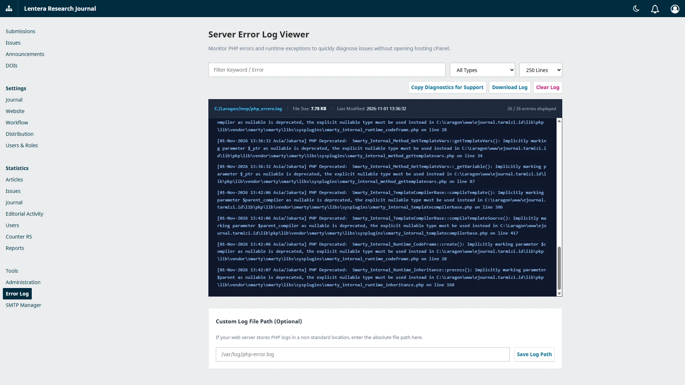

# OJS Error Log Viewer Plugin

[](https://www.php.net/)
[](https://www.smarty.net/)
[](https://developer.mozilla.org/en-US/docs/Web/JavaScript)
[](https://developer.mozilla.org/en-US/docs/Web/CSS)

A lightweight and essential utility plugin for Open Journal Systems (OJS) that empowers journal managers and administrators to view, inspect, search, and copy server error logs (`error_log`) directly from the OJS editorial dashboard without requiring cPanel or SSH access.



## Key Features

- **No cPanel / SSH Needed**:
  - Automatically resolves standard server PHP error log paths (`ini_get('error_log')`, root `error_log`, `files_dir/error_log`, Linux server logs).
  - Customizable absolute path setting for non-standard hosting environments.
- **High Performance Memory-Safe Reader**:
  - Reads the tail lines of the log file using reverse binary file-seeking (`fseek`), ensuring zero memory exhaustion even on large log files (hundreds of megabytes).
  - Selectable tail ranges: 100, 250, 500, or 1000 lines.
- **Live Search & Level Filtering**:
  - Instant live filtering by keywords directly in the dashboard browser.
  - Color-coded severity highlights: **Fatal Error** (Red), **Warning** (Yellow), **Notice / Deprecated** (Blue).
- **One-Click Support & Consultation Diagnostics**:
  - Dedicated **"Copy Diagnostics for Support"** button that automatically collects the latest critical errors alongside PHP and OJS system versions into the user's clipboard for easy sharing on WhatsApp, Telegram, or forum support.
- **Log Management**:
  - Download full raw log file directly to your local computer.
  - In-place log clearing with confirmation.
- **Strict Access Control**:
  - Protected by OJS authentication and authorization checks restricted strictly to Site Administrators and Journal Managers.

## Installation

1. Clone or copy the repository to your OJS plugins directory:
   ```bash
   git clone https://github.com/openjournalcenter/ojs-error-log-viewer.git plugins/generic/errorLogViewer
   ```
   *Or extract the release archive into `plugins/generic/errorLogViewer`.*

2. Ensure correct directory permissions:
   ```bash
   chmod -R 755 plugins/generic/errorLogViewer
   ```

3. Log in to OJS as Journal Manager or Site Administrator.

4. Navigate to **Settings > Website > Plugins > Installed Plugins**.

5. Locate **Error Log Viewer** under **Generic Plugins** and enable it.

6. An **Error Log** menu will appear in the dashboard navigation sidebar.

## Authors & Maintainers

- **Author**: Dimar Tarmizi
- **Organization**: [Open Journal Center](https://github.com/openjournalcenter)
- **Repository**: [https://github.com/openjournalcenter/ojs-error-log-viewer](https://github.com/openjournalcenter/ojs-error-log-viewer)

## License

This plugin is licensed under the [GNU General Public License v3.0](LICENSE).
